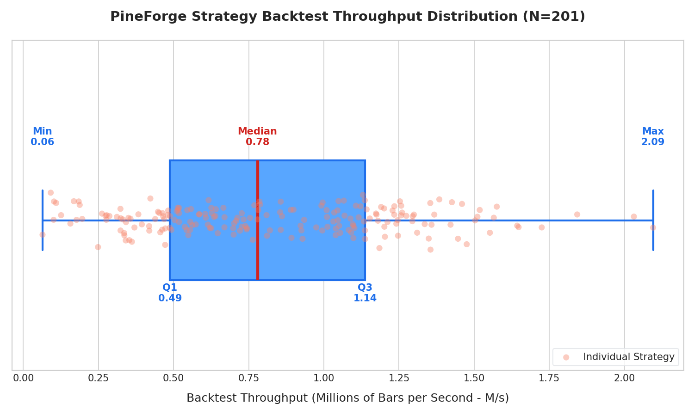

# PineForge Performance & Optimization Reproduction Package

This directory contains the tools, scripts, and instructions to reproduce the high-performance backtest throughput benchmarks and strategy parameter optimizations for the PineForge engine.

---

## 📊 Reproduction Results

### Throughput Distribution (N=201)

Below is the boxplot chart showing the distribution of backtest throughput across the 201 bench slots (the 100 public corpus probes and the maintainers' 101 closed scripts). The individual data points (jittered orange circles) correspond to the throughput of each compiled C++ strategy running on the 53,929-bar ETHUSDT 15m feed.



### Tabulated Throughput Statistics

| Quartile Metric | Throughput (Millions of Bars per Second - M/s) | Equiv. Execution Time (per 10k bars) |
| :--- | :---: | :---: |
| **Minimum** | 0.064 M/s | 156.04 ms |
| **Q1 (25th Percentile)** | 0.488 M/s | 20.50 ms |
| **Median (50th Percentile)** | **0.779 M/s** | **12.84 ms** |
| **Q3 (75th Percentile)** | 1.137 M/s | 8.79 ms |
| **Maximum** | 2.095 M/s | 4.77 ms |

*Note: the metric is GBench's `<slug>/throughput/no_magnifier` hot loop. Each strategy's shared library is `dlopen`ed once, outside the timed region. Each of the 20 timed iterations runs `strategy_create`, applies the slot's `inputs.json` `strategy_overrides` pins, and runs `run_backtest` over the whole feed with the bar magnifier off; the table reports the mean.*

*Last measured 2026-09-29 on a dedicated AWS c7a.8xlarge (AMD EPYC 9R14, 32 cores, SMT off) running Ubuntu 24.04, pinned to one core, with engine `main` `35db01c8`. This is the median of five quiet runs: the five run medians were 0.782, 0.786, 0.778, 0.779 and 0.777 M/s, and the table and chart come from the run with the median result (run 4). Every run started at a 1-minute load below 6 with no build or test process running; the loads are in [`../results/speed.md`](../results/speed.md). A public checkout only has the 100 public slots, whose median in the same run is 1.050 M/s. The five runs' Google Benchmark files and load traces are in [`../results/raw/2026-09-29-35db01c8/throughput/`](../results/raw/2026-09-29-35db01c8/throughput/); run 4 is byte-identical to `benchmark_results.json`.*

*Earlier figures were measured on an Apple M4 Max and are not compared with these: 0.638 M/s on 2026-09-22 (engine `063e4460`), and 17.05 M/s on 2026-05-29 (100 strategies, a 41,307-bar feed). On this host, in one window, engine `35db01c8` takes 0.35× the time of `063e4460` per strategy at the median with the magnifier on, and the engine of the 2026-06-11 speed table runs the three probes both populations share 4–8× faster than `35db01c8` (see [`../results/speed.md`](../results/speed.md), Provenance).*

### 🛠️ FFI Grid Search Optimization Result

`grid_search_repro.py` runs a multi-parameter grid search in memory, through Python ctypes FFI, on the compiled C++ shared library for `021-composite-scalping-integration-01`: an EMA-cross scalper with take-profit and stop-loss exits in ticks. The sweep covers 27 combinations: Fast EMA 3/5/7 × Slow EMA 11/13/15 × take profit 10/15/20 ticks, with the stop loss held at its default of 7 ticks.

The CR-150 HPO host requires a module built with `hpo_bridge.cpp` and the integrated
report-output/v1 and scratch-window implementations. It fills one shared OHLCV
array directly from a second CSV pass, selects `OutputModeV1::Summary` on every
fresh trial, installs a fixed resident-window manifest, and reads frozen metrics
and logical trade/point counts. Trials create no full report object. Legacy
modules missing the contract fail before any trial; the host cannot fall back to
retaining a curve.

On the lab, build the bridge-enabled slot and pass its path explicitly:

```bash
cmake -S benchmarks/throughput -B build-hpo -DCMAKE_BUILD_TYPE=Release
cmake --build build-hpo --target pineforge_hpo_grid -j4
python3 benchmarks/throughput/grid_search_repro.py --library build-hpo/lib/libpineforge_hpo_grid.so
```

Use the corresponding module suffix/path emitted by CMake on macOS. Existing
module builds can include `benchmarks/throughput/hpo_bridge.cmake` and call
`pineforge_attach_hpo_bridge(the_strategy_target)` after creating their target.
The bridge must link into that same module and runtime. Its new C symbols are
benchmark exports; the engine's public C layouts and ABI version remain unchanged.
The resident-window budget is a cache geometry, with exact history handled by
the shared table implementation; it is never a limit on accepted bars or trades.

- **Best configuration:** Fast EMA = 3, Slow EMA = 15, take profit = 20 ticks
- **Net profit:** **−103.16 USDT**. The probe is a mechanism test, not a profitable strategy: every combination loses. The sweep demonstrates the FFI loop, not an edge.
- **Trade count:** 5,153 trades over 53,929 bars of 15m ETHUSDT (recorded 2026-09-29 at engine `35db01c8`, as at `e9ad37dd` on 2026-09-22)

### CR-220: streamed TrialRecords, top-k retention and `--ohlcv-bin`

| Option | Meaning |
|---|---|
| `--trial-log PATH` | Append one fixed-size `TrialRecord` per finished trial and flush it before the next trial starts. The file is created exclusively: an existing path is refused, never truncated. |
| `--trial-log-max-bytes N` | Per-run byte cap for `--trial-log`, the 64-byte header included (default 1 GiB). Must be a positive integer. A record that would cross the cap is refused with a typed `TrialLogCapError` before it is written, and the sweep aborts with a non-zero exit. |
| `--top-k K` | Retain at most K records in memory for the final ranking (default 10). Must be a positive integer (argparse refuses 0, negatives and non-integers with exit 2). Ties are broken by the lower trial index, so `--top-k 1` reproduces the old first-wins best, including its printed `Best Profit` line. A failed trial, a NaN and an `-inf` net profit never enter the ranking (the old scan compared strictly against its `-inf` initial best), so `--top-k 1` is exactly the old scan. |
| `--ohlcv-bin PATH` | Read the shared bar array from a `pf_bar_t/v1` file instead of `--ohlcv-csv`. The two options are mutually exclusive. The CSV loader refuses a zero-data-row file (header only, empty, or only blank/short rows) with exit 1 and a message; every non-empty CSV loads exactly as before. |

**Record layout** — little-endian, fixed offsets, no on-disk padding. A 64-byte
header (`b"PFTRIAL\x01"`, version 1, record size 128, 8 parameter slots) is
followed by 128-byte records in trial order:

| Offset | Type | Field |
|---:|---|---|
| 0 | uint32 | trial index (0-based, strictly increasing) |
| 4 | uint32 | status: 0 = ok, 1 = failed |
| 8 | float64 | net profit (IEEE bits preserved; NaN on failure) |
| 16 | int64 | total trades (−1 on failure) |
| 24 | uint32 | parameter count |
| 28 | uint32 | reserved, zero |
| 32 | 32 bytes | SHA-256 of the trial's 768-byte raw metrics block (zeros on failure) |
| 64 | 8 × float64 | parameter values; unused slots are 0.0 |

A failed trial is written with its status and then the sweep re-raises, so it
can never enter the ranking. The record carries the metrics *digest*, not the
768 bytes, so the file grows by exactly 128 bytes per trial.

**Disk cap.** `--trial-log-max-bytes N` (default `2**30` = 1 GiB) counts the
64-byte header. Each record is exactly 128 bytes, so the cap converts to trials
by arithmetic: `(1 GiB - 64) / 128 = 8,388,607` whole records fit after the
header, and the next record is refused. Before writing a record the host
compares `written_bytes + 128` with the cap; if it would cross, it flushes
what is on disk and raises a typed `TrialLogCapError` (a subclass of
`TrialLogError`, the host's trial-log I/O error family) carrying
`.written_bytes`, `.cap_bytes` and `.trial_index`. The crossing record is never
written — not partially, not silently dropped, and the file is never truncated
or rotated — so `iter_trial_log` still reads every record that was written and
the file size is exactly `64 + written_records * 128`. A cap smaller than the
header is refused before the file is created, and a non-positive or
non-integer value is refused by argparse.

**Removal policy.** The log is a **caller-owned artifact**: the caller named
the path and the sweep created it exclusively (`"xb"`; an existing path is
refused, never truncated). The host never deletes it — not on success, not on
a failed sweep, and not on a capped one — and without `--trial-log` no file
exists at all. This is deliberately different from the engine's CR-150 scratch
files (`include/pineforge/detail/scratch_file.hpp:29-70`), which are
run-owned, anonymous and unlinked at creation, so they vanish with the run:
the engine created those for itself. The trial log exists because the caller
asked for it as the sweep's result, so it belongs to whoever named it and
outlives the sweep.

**Memory.** Retained host state is **O(k)**: the k-entry ranking heap plus fixed
scalars. The log lives on disk; the shared bar array is O(B) and allocated once;
no list or dict of per-trial results is kept. Nothing in the sweep retains N
records.

**`--ohlcv-bin` decoding.** Headerless 48-byte records `struct "<5dq"` — open,
high, low, close, volume as little-endian binary64, then the bar-open timestamp
as a little-endian int64 Unix millisecond — per `docs/design/BARS-BIN-INPUT.md`
section 1. The file is mapped read-only and copied into one contiguous
`pf_bar_t` array with `from_buffer_copy`; no per-row Python object is built.
The host refuses, with a typed `BarsBinError` (a `ValueError` with a `reason`
code): a non-regular or missing file (`not_a_file`), a size that is not a
multiple of 48 (`size_not_multiple_of_48`), an empty file (`empty`), more than
2³¹−1 bars (`too_many_bars`), and a host whose `pf_bar_t` is not the 48-byte
little-endian wire record (`host_layout`).

```bash
python3 benchmarks/throughput/grid_search_repro.py \
    --library build-hpo/lib/libpineforge_hpo_grid.so \
    --ohlcv-bin bars.bin --trial-log run.trials --top-k 10
```

**Not done here.** The sidecar (`PATH.json`, `"format": "pf_bar_t/v1"`) is not
read or verified, and no digest is recomputed: the HPO decoder validates file
size, non-emptiness and host layout only. There is no big-endian byte swapping
(such hosts are refused), no parallel or resumable sweep, and no consumer of
`--trial-log` inside this repository — external HPO/APP drivers are outside
this repo and remain the report's UNPLACED boundary.

---

## 📦 Materials Included

1. **`reproduce.sh`**: The end-to-end automation bash script.
2. **`plot_quartile.py`**: Python script using NumPy and Matplotlib to parse benchmark JSON, calculate exact throughput quartiles, and generate the boxplot chart (`throughput_quartiles.png`).
3. **`grid_search_repro.py`**: Multi-parameter grid search optimizer script using ctypes FFI to sweep parameters on the compiled `021-composite-scalping-integration-01` library. It streams one fixed-size trial record per trial (`--trial-log`), keeps only the top-k records in memory (`--top-k`, default 10), and reads bars from either `--ohlcv-csv` or a `pf_bar_t/v1` `--ohlcv-bin` file.

---

## 🚀 How to Reproduce

### 1. Prerequisites

Initialise the assets submodule (`git submodule update --init benchmarks/assets`), and have Python 3, CMake ≥ 3.20 (the build fetches Google Benchmark), a C++17 compiler (e.g. clang or gcc), and the Python plotting dependencies installed:

```bash
pip install matplotlib numpy
```

### 2. Run the End-to-End Pipeline

Execute the main wrapper script directly from this directory:

```bash
chmod +x reproduce.sh
./reproduce.sh
```

This script will:
1. Recompile the backtest engine and every bench strategy in **Release mode**: the 100 public slots, plus the 101 closed slots when the maintainers' `benchmarks/assets-closed/` root is present.
2. Run Google Benchmark suites across all strategies for dynamic throughput measurement, exporting results to `benchmark_results.json`.
3. Compute the exact distribution quartiles (Min, Q1, Median, Q3, Max) and print them.
4. Render the distribution boxplot chart to `throughput_quartiles.png`.
5. Run the in-memory parameter sweep grid search on `021-composite-scalping-integration-01` and output the optimized parameters.

---

## 🔍 Auditing & Verifying Results (For Sceptics)

You can audit these figures (such as the median hot-loop throughput of 0.78 million bars per second) step by step:

### A. Run a Single Strategy Individually
Instead of running every slot, you can compile and benchmark a single strategy of your choice (e.g. `001-analyzer-anvil-percent-costs-01`) using Google Benchmark directly to eliminate any script wrapper bias:

```bash
# From the project root:
cmake -B build -DPINEFORGE_BUILD_BENCH_STRATEGIES=ON -DPINEFORGE_BUILD_SPEED_BENCH=ON -DPINEFORGE_BUILD_TESTS=ON
cmake --build build --target bench_strategies pineforge_bench -j4

# Execute only the chosen strategy benchmark:
./build/bin/pineforge_bench --benchmark_filter="001-analyzer-anvil-percent-costs-01"
```

### B. Audit the Generated C++ Strategy Code
Every strategy's Pine Script v6 is compiled to native, modern C++17. You can inspect the fully generated C++ files inside each strategy directory (e.g., `benchmarks/assets/strategies/001-analyzer-anvil-percent-costs-01/generated.cpp`) to verify that they are:
1. Performing genuine, complex math and indicators (no mock shortcuts).
2. Leveraging in-memory sliding window lookups instead of slow databases.
3. Accessing trades and executing orders in `O(1)` time complexity.

### C. Verify the FFI Grid Search Performance
To verify that the FFI parameters are actually being set correctly and the optimization is genuine, run `grid_search_repro.py`; it prints every parameter combination it runs:

```bash
# Run grid search directly
python3 grid_search_repro.py
```
This script accesses the compiled strategy's inputs using Python `ctypes` by calling `strategy_set_input`, showing how easily PineForge integrates into modern quantitative analysis environments with zero translation overhead.
